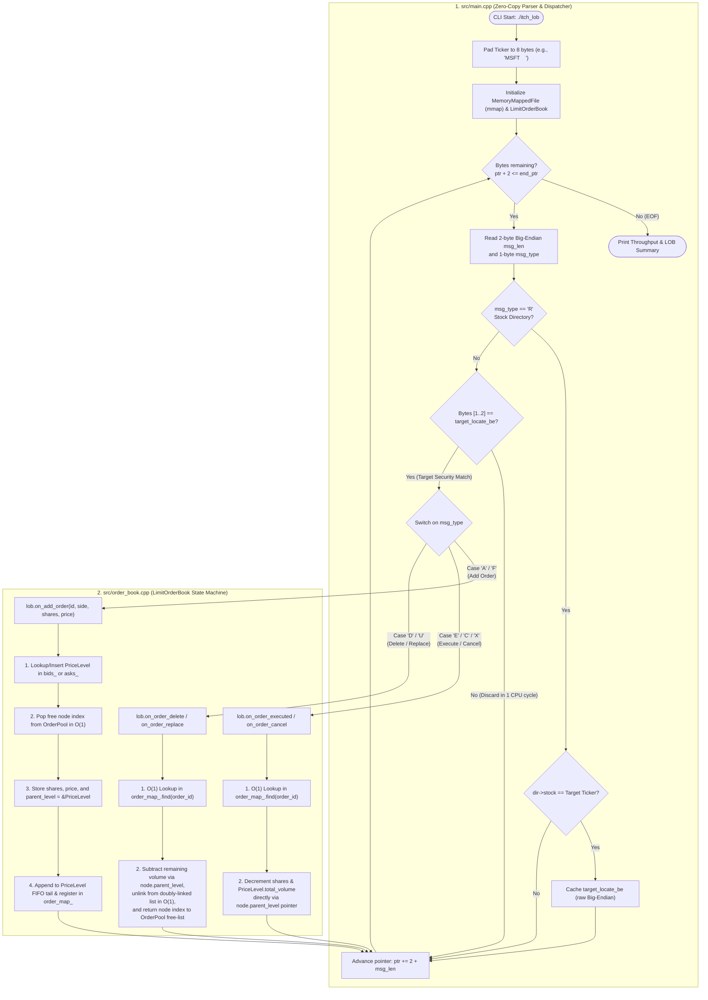

# High-Frequency NASDAQ TotalView-ITCH 5.0 Parser & Limit Order Book (C++20)

A low-latency, zero-allocation market data feed handler and Limit Order Book (LOB) reconstruction engine written in modern **C++20**. 

Designed with Mechanical Sympathy and High-Frequency Trading (HFT) systems engineering principles, this engine parses raw uncompressed **NASDAQ TotalView-ITCH 5.0** binary files and reconstructs the full Market-By-Order (MBO) state machine in real time at **>40 million messages per second** on a single CPU core.

---

## Key Architectural Highlights

* **Zero-Copy File I/O (`mmap` + `MADV_SEQUENTIAL`):** Bypasses standard user-space I/O buffering (`std::ifstream`/`fread`) by mapping multi-gigabyte NASDAQ binary tapes directly into the process virtual address space via POSIX `mmap`, instructing the OS kernel to aggressively prefetch pages sequentially.
* **Zero-Copy Wire Casting (`#pragma pack(1)`):** Maps raw network bytes directly onto packed C++ POD structures via `reinterpret_cast` with compile-time `static_assert` size verification and single-cycle hardware endianness conversion (`__builtin_bswap16/32/64`).
* **1-Cycle Big-Endian Ticker Filtering:** Dynamically resolves human-readable ticker symbols (e.g., `AAPL`, `MSFT`) from Stock Directory (`'R'`) messages into their 16-bit `stock_locate` ID, keeping the target ID in network byte order (Big-Endian) to discard unrelated market messages in a single CPU comparison instruction before decoding.
* **Zero Runtime Heap Allocations (`OrderPool`):** Eliminates `new`/`delete` and `malloc`/`free` overhead on the hot path by pre-allocating a contiguous arena of `OrderNode` objects managed via an $O(1)$ intrusive free-list using 32-bit indices (`uint32_t`) instead of 64-bit pointers to maximize CPU L1/L2 cache density.
* **$O(1)$ Order Book State Machine:** Combines an `OrderID -> PoolIndex` lookup table with intrusive doubly-linked FIFO queues at each price level and direct `PriceLevel*` parent pointers inside every node, achieving $O(1)$ time complexity for order executions, partial cancellations, and deletions without redundant tree lookups.
* **Fixed-Point Price Arithmetic:** Represents all prices as 32-bit integers (`price * 10,000`) throughout the matching and indexing pipeline to prevent IEEE 754 floating-point precision drift and key corruption.

---

## System Architecture & Event Flow


# Supported ITCH 5.0 Messages
|Type|Message Name|Wire Size|LOB Impact|
|----|------------|---------|----------|
|R|Stock Directory|39 bytes|Maps 8-byte ASCII ticker symbol to 2-byte numeric stock_locate ID.|
|A|Add Order (No MPID)|36 bytes|Allocates an OrderNode from the pool and appends it to the FIFO tail of the corresponding PriceLevel.|
|F|Add Order (With MPID)|40 bytes|Processed identically to 'A' (broker attribution ignored for aggregate book depth).|
|E|Order Executed|31 bytes|Decrements resting order quantity and PriceLevel volume in $O(1)$; deletes order if fully filled.|
|C|Order Executed With Price|36 bytes|Updates resting order quantity and book liquidity identically to 'E'.|
|X|Order Cancel|23 bytes|Partially reduces resting order quantity in $O(1)$ while preserving time priority.|
|D|Order Delete|19 bytes|Unlinks order from the PriceLevel queue in $O(1)$, recycles the node in OrderPool, and erases empty price levels.|
|U|Order Replace|35 bytes|Removes original order_ref and inserts new_order_ref at the tail of the new price level (loses time priority).|

# Benchmark Results
Tested on a full-day uncompressed NASDAQ TotalView-ITCH 5.0 capture (01302019.NASDAQ_ITCH50):
- File Size: 10,724 MB (~10.7 GB)
- Total Market Messages Parsed: 368,366,634

|Target Security|Stock Locate|Reconstructed Book Events|Total Execution Time|End-to-End Throughput|
|---------------|------------|-------------------------|--------------------|---------------------|
|AAPL|14|1,656,597|9.100 s|40.48 M msgs/sec|
|MSFT|5217|1,642,525|8.744 s|42.13 M msgs/sec.

# Project Structure
```
├── CMakeLists.txt              # CMake build config (-O3 -march=native -flto)
├── include/
│   ├── endian_utils.hpp        # Compiler intrinsics for byte-swapping & 48-bit timestamp decoding
│   ├── itch_protocol.hpp       # Packed ITCH 5.0 wire structs with compile-time size checks
│   ├── mmap_file.hpp           # RAII POSIX memory-mapped file reader
│   ├── order_pool.hpp          # Contiguous object pool with O(1) intrusive free-list
│   └── order_book.hpp          # LimitOrderBook class definition and PriceLevel ladders
└── src/
    ├── order_book.cpp          # O(1) LimitOrderBook state machine implementation
    └── main.cpp                # CLI entry point, fast locate filter, and parsing loop
```

# Build & Run Instructions
## Prerequisites
- Linux or macOS environment (for POSIX mmap support)
- C++20 compatible compiler (GCC 10+ or Clang 12+)
- CMake 3.16+
- An uncompressed NASDAQ ITCH 5.0 binary file (public sample files available at emi.nasdaq.com/ITCH/Nasdaq ITCH/)
## Compilation
```Bash
mkdir build && cd build
cmake ..
make -j$(nproc)
```
## Usage
Run the engine by passing the path to the uncompressed ITCH 5.0 binary file and the target ticker symbol:
```Bash
./itch_lob /path/to/<mmddaaaa>.NASDAQ_ITCH50 <TICKER>
```